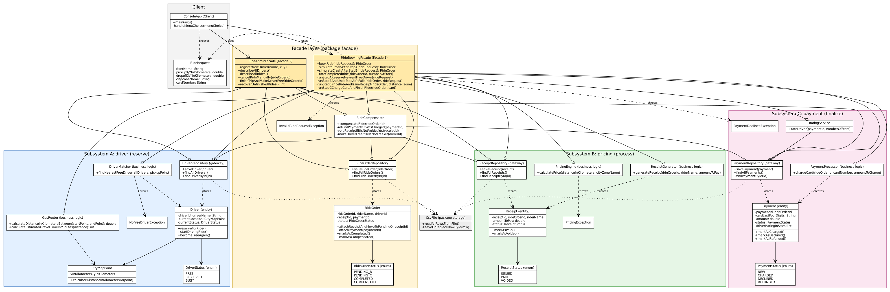

# Ride-Hailing: Facade over a three-stage chain (Assignment 4, variant 3)

A ride is booked in three steps that belong to three independent subsystems:

| Step | Subsystem | Package | What it does |
|------|-----------|---------|--------------|
| A | Driver Matcher, GPS Router | `ridehailing.driver` | reserves the nearest free driver, calculates the distance |
| B | Pricing Engine, Receipt Generator | `ridehailing.pricing` | prices the ride, issues a receipt |
| C | Payment Processor, Rating Service | `ridehailing.payment` | charges the card, lets the rider rate the driver |

The client calls **one** method (`RideBookingFacade.bookRide`). If step B or step C fails, the facade undoes what was
already saved. All state lives in CSV files, so it survives a restart.

## 1. Run it

Requirements: Java 11+ and Maven (IntelliJ IDEA: File -> Open -> the folder with `pom.xml`).

```
mvn verify                      # compile, run all tests, JaCoCo report, 80% coverage check
mvn -q compile exec:java        # start the console demo (or run ConsoleApp.main() in the IDE)
```

* Coverage report: `target/site/jacoco/index.html` (JaCoCo; the console menu and the standalone mains are excluded).
* **Reset to a clean state:** stop the program and delete the `data` folder. The next start creates it again and registers 3 drivers.
* Each subsystem also works **alone**: run `DriverSubsystemMain`, `PricingSubsystemMain` or `PaymentSubsystemMain` from `ridehailing.standalone`.

Console menu: `1` book a ride with your own data, `2` step B fails, `3` step C fails, `4` / `5` crash after step A / B,
`6` restart (open the files again and recover), `7` / `8` show drivers / rides, `9`-`12` rate, finish a trip, cancel by hand, add a driver.

## 2. Subsystems

Each subsystem has an entity with its own status, business-logic classes and a persistence gateway (`...Repository`, it talks to
a CSV file directly). The entities refuse illegal status changes themselves:

* `Driver`: FREE -> RESERVED -> BUSY -> FREE, and RESERVED -> FREE
* `Receipt`: ISSUED -> PAID, ISSUED -> VOIDED, PAID -> VOIDED
* `Payment`: NEW -> CHARGED, NEW -> DECLINED, CHARGED -> REFUNDED

No subsystem imports another one; they meet only in the facade layer. `RideOrder` (the saved progress of the chain) stores only the
**ids** of the records of A, B and C. `RideRequest` uses plain numbers and texts, so the client never needs a subsystem class.
There are two facades: `RideBookingFacade` (book and rate a ride) and `RideAdminFacade` (inspect, cancel by hand, recover after a crash).

## 3. Chain and compensation

```
bookRide(rideRequest)
  check the request                                 -> InvalidRideRequestException   (nothing saved)
  A: find the nearest free driver                   -> NoFreeDriverException         (nothing saved)
     save the ride as PENDING_B, then reserve the driver (RESERVED)
  B: price the ride, issue the receipt (ISSUED)     -> any failure                   => undo A
     the ride becomes PENDING_C
  C: charge the card                                -> any failure (card declined)   => undo B, then A
     receipt PAID, driver BUSY, the ride becomes COMPLETED
```

| Failure | On disk when it happens | The facade undoes |
|---------|-------------------------|-------------------|
| **B fails after A** (unknown zone, price too high, storage error) | ride PENDING_B, driver RESERVED | **A alone**: driver FREE, ride COMPENSATED |
| **C fails after A and B** (card declined, storage error) | ride PENDING_C, receipt ISSUED | **B, then A**: receipt VOIDED, driver FREE, ride COMPENSATED |

`RideCompensator.compensateRide` reads the ride **from disk** and undoes only what the saved ride says was done, in the order
C -> B -> A; every undo is guarded, so running it twice does no harm. After a restart, `RideAdminFacade.recoverUnfinishedRides()`
finds rides still `PENDING_B` / `PENDING_C` on disk (the application died in the middle of the chain) and compensates them.

## 4. Principle of Least Knowledge: before / after

**Before** (no facade): the client must know, create and call the objects of all three subsystems, remember the order, and write
the rollback itself:

```java
DriverRepository driverRepository = new DriverRepository(folder);
ReceiptRepository receiptRepository = new ReceiptRepository(folder);
PaymentRepository paymentRepository = new PaymentRepository(folder);

Driver driver = new DriverMatcher().findNearestFreeDriver(driverRepository.findAllDrivers(), pickupPoint);
driver.reserveForRide();
driverRepository.saveDriver(driver);
double distance = new GpsRouter().calculateDistanceInKilometersBetween(pickupPoint, dropoffPoint);
try {
    double price = new PricingEngine().calculatePrice(distance, "CENTER");   // may throw
    Receipt receipt = new ReceiptGenerator().generateReceipt(rideOrderId, "Aibek", price);
    receiptRepository.saveReceipt(receipt);
    Payment payment = new PaymentProcessor().chargeCard(rideOrderId, cardNumber, price);
    paymentRepository.savePayment(payment);
    if (payment.getStatus() == PaymentStatus.DECLINED) { receipt.markAsVoided(); /* ...and free the driver... */ }
} catch (PricingException e) { driver.becomeFreeAgain(); driverRepository.saveDriver(driver); }
```

**After** (with the facade): the client has two immediate friends, the facade and the request.

```java
RideBookingFacade rideBookingFacade = new RideBookingFacade(Path.of("data"));
rideBookingFacade.bookRide(new RideRequest("Aibek", 0, 0, 3, 4, "CENTER", cardNumber));
```

The client never touches a subsystem class. The facade works with its own components (its fields), the objects it creates and its parameters.

## 5. Facade vs. Adapter (reflection)

An **Adapter** exists to fix an *incompatibility*: the client expects interface X, the existing class offers interface Y, and the
adapter translates between them without adding any workflow. In this project nothing is incompatible. `DriverMatcher`,
`PricingEngine` and `PaymentProcessor` are written for our own use and their methods already do what their names say.

The real problem is *complexity and coordination*: booking a ride needs three unrelated subsystems called in a fixed order, data handed
from one to the next (distance -> price -> receipt amount -> payment), and a rollback that depends on how far the chain got. If the
client did that itself it would know a dozen classes and repeat the rollback logic in every place that books a ride. The **Facade**
gives one simple entry point (`bookRide`) and keeps the sequence, the decisions and the compensation in one place. Its intent is
"make a complex set of subsystems easy to use and decouple the client from it", not "make one interface look like another". That is
also why there are two facades over the same three subsystems (everyday use and administration), which is normal for a Facade and
meaningless for an Adapter. The subsystems stay usable directly, and they do not know that a facade exists.

## 6. Tests and UML

* Tests (`mvn verify`): each subsystem alone, both compensation depths (B fails after A, C fails after A and B, each asserting the end state on
  disk), persistence-reload tests (a ride interrupted mid-chain, restart, recovery from what is on disk), invalid input, storage errors.
  Every test uses its own empty temporary folder. The test helper `RideHailingTestWorld` is the domain-specific testing language
  (`world.givenFreeDriver(...)`, `world.assertDriverIs(...)`, `world.restartApplication()`).
* UML class diagram: `docs/class-diagram.png` / `docs/class-diagram.svg` (source `docs/class-diagram.dot`).


